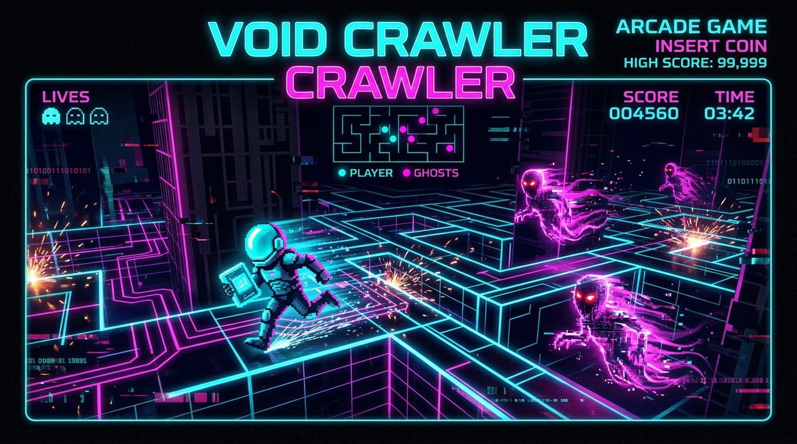

# 👾 Void Crawler

<div align="center">

[](https://github.com/leonardoconstantino/void-crawler/actions/workflows/deploy.yml)
[](https://react.dev/)
[](https://vitejs.dev/)
[](https://www.typescriptlang.org/)
[](https://tailwindcss.com/)
[](LICENSE)

<br />

🎮 **[Jogar Void Crawler no GitHub Pages](https://leonardoconstantino.github.io/void-crawler/)** 🕹️

</div>

---

## 🖼️ Visão Geral

<div align="center">
  
</div>

<br />

**Void Crawler** é um jogo arcade roguelike cyberpunk ambientado nas entranhas de um computador corrompido. No papel de um fragmento de código consciente (o *Core Entity*), sua missão é percorrer labirintos procedurais nas diferentes camadas de memória do sistema, coletar fragmentos de integridade e escapar de espectros de memória corrompidos enquanto o sistema sofre instabilidades de glitch em tempo real.

---

## ✨ Principais Recursos

- 🌀 **Geração Procedural de Labirintos**: Algoritmo depth-first search customizado com abertura estocástica de atalhos e túneis de teletransporte (Warp Portais), garantindo layouts únicos a cada partida sem becos sem saída frustrantes.
- 🧱 **3 Camadas de Sistema**:
  - **RAM (Local Memory)**: Camada de entrada, rápida e com ampla visibilidade.
  - **KERNEL (Core Space)**: Labirintos mais densos com múltiplos portais e maior densidade de espectros.
  - **BIOS (Firmware)**: Núcleo de alta compressão com glitches mais frequentes e IA hostil implacável.
- 👻 **Inteligências Artificiais Espectrais com Comportamentos Distintos**:
  - `SPECTER_A (Hunter)`: Perseguição direta ao jogador.
  - `SPECTER_B (Predictor)`: Cálculo preditivo para interceptar a posição futura do jogador.
  - `SPECTER_C (Flanker)`: Flanqueamento em ângulo de emboscada.
  - `SPECTER_D (Glitch/Erratic)`: Patrulha instável e desvios imprevisíveis.
- ⚡ **Kernel Exploits (Buffer Overcharge)**: Colete módulos de sobrecarga de memória para inverter a caçada — durante a vulnerabilidade dos espectros, você pode consumi-los para pontuações bônus astronômicas.
- 🔊 **Áudio Sintetizado via Web Audio API**: Efeitos sonoros espaciais e sintetizadores procedurais de onda senoidal, dente-de-serra e ruído branco criados 100% via código no navegador, sem bibliotecas pesadas de mídia.
- 💾 **Ghost Replay Local**: Gravação da sua melhor rota anterior, projetando um espectro fantasma translúcido de você mesmo para desafiar seu próprio recorde.
- 🏆 **Placar e Persistência**: Recordes e estatísticas de integridade persistidos automaticamente no `localStorage`.
- 📱 **Controles Responsivos e Suporte Mobile**: Teclado completo e botões direcionais virtuais na tela para dispositivos móveis ou telas sensíveis ao toque.

---

## 🕹️ Guia de Controles & Como Jogar

| Ação | Teclado (Desktop) | Touch (Mobile) |
| :--- | :--- | :--- |
| **Mover Entidade** | `Setas` ou `W, A, S, D` | D-Pad virtual na tela |
| **Pausar / Continuar** | `Espaço` ou `P` | Botão **Pause** no painel superior |
| **Mutar / Ativar Som** | `M` | Botão de Áudio no HUD |
| **Reiniciar Ciclo** | `R` | Botão **Restart** no painel |

### Objetivos:
1. **Colete todos os Fragmentos de Dados** para estabilizar o setor e destravar o portal para a próxima camada.
2. **Evite contato com os Espectros** a menos que tenha acionado um **Kernel Exploit**.
3. **Use os Portais de Teletransporte (Warp)** nas bordas para escapar de encurralamentos.
4. **Vença a BIOS** para salvar o sistema da corrupção absoluta!

---

## 💻 Instalação e Desenvolvimento Local

### Pré-requisitos
- [Node.js](https://nodejs.org/) versão 18 ou 20+
- [npm](https://www.npmjs.com/) ou [pnpm](https://pnpm.io/) ou [bun](https://bun.sh/)

### 1. Clonar o repositório
```bash
git clone https://github.com/leonardoconstantino/void-crawler.git
cd void-crawler
```

### 2. Instalar dependências
```bash
npm install
```

### 3. Iniciar o servidor de desenvolvimento
```bash
npm run dev
```
Acesse `http://localhost:3000` no seu navegador.

### 4. Compilação para produção e preview
```bash
npm run build
npm run preview
```

### 5. Verificação de Tipos e Linter
```bash
npm run lint
```

---

## 🚀 Deploy Automático no GitHub Pages

O projeto conta com uma esteira de CI/CD via **GitHub Actions** configurada em [`.github/workflows/deploy.yml`](.github/workflows/deploy.yml).

### Como funciona:
1. Ao realizar um `push` na branch `main` ou `master` (ou ao disparar manualmente via `workflow_dispatch`), o GitHub Actions:
   - Configura o ambiente Node.js 20.
   - Instala as dependências de forma limpa.
   - Executa a build estática com `GITHUB_ACTIONS=true` (configurando automaticamente a base URL para `/void-crawler/`).
   - Publica o conteúdo da pasta `dist/` diretamente no GitHub Pages através das ações oficiais `actions/upload-pages-artifact@v3` e `actions/deploy-pages@v4`.

### Configuração necessária no GitHub (única vez):
Para que o workflow consiga publicar na URL pública:
1. No repositório no GitHub, clique na aba **Settings**.
2. No menu lateral esquerdo, selecione **Pages**.
3. Em **Build and deployment** > **Source**, altere para **GitHub Actions**.
4. Pronto! O workflow cuidará de todo o ciclo de build e publicação a cada atualização.

---

## 📜 Licença

Distribuído sob a licença **MIT**. Consulte o arquivo [LICENSE](LICENSE) para obter mais informações.
